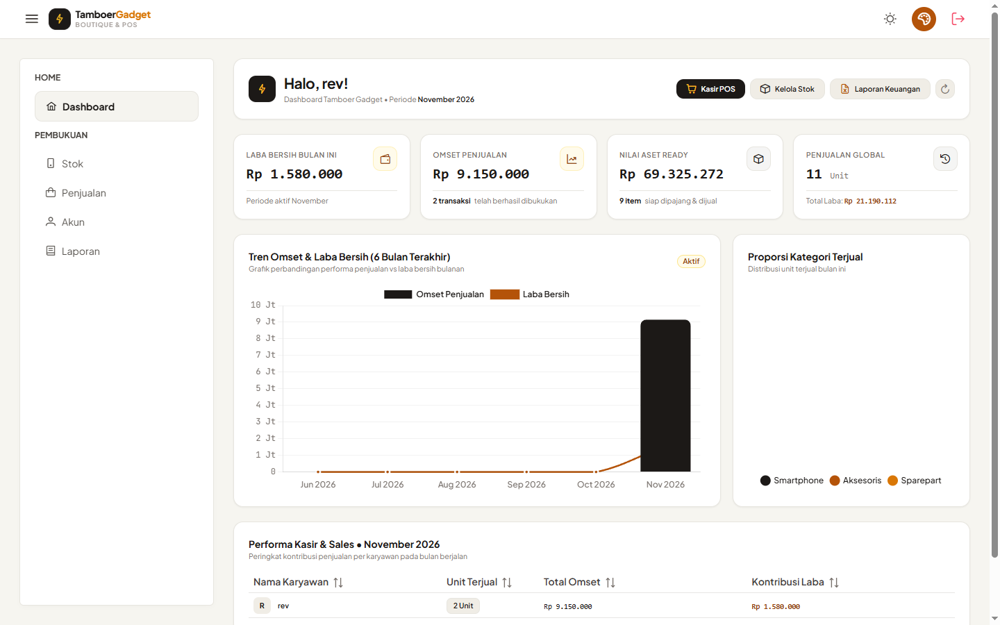
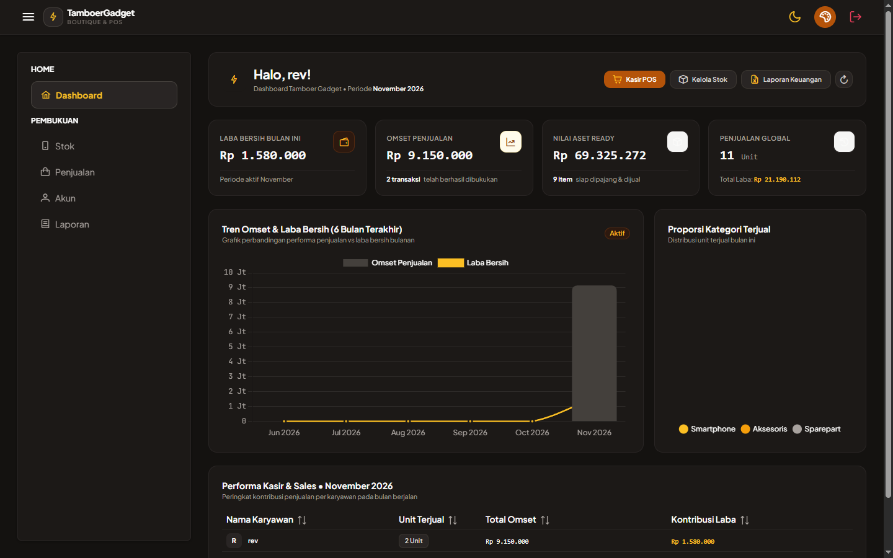
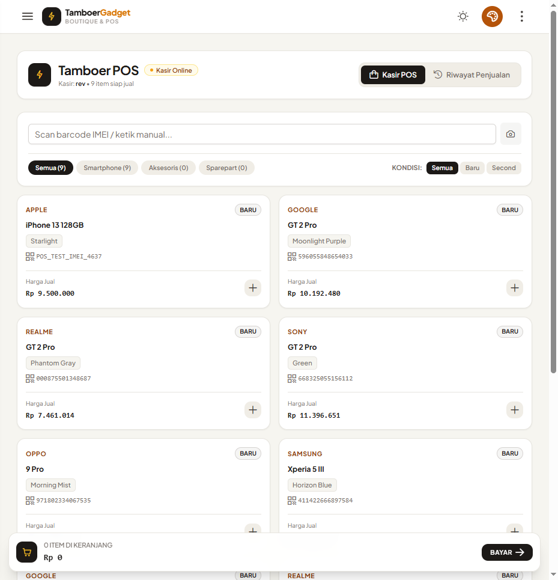
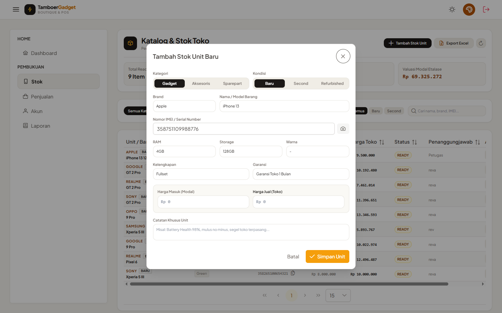
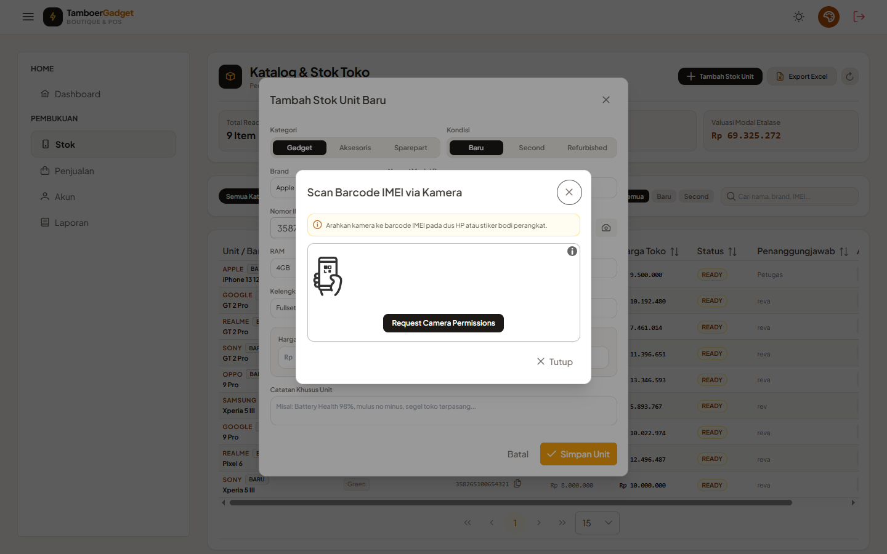

# 📱 Tamboer Gadget — Boutique POS & Inventory Management System

<p align="center">
  
</p>

<p align="center">
  
  
  
  
  
  
</p>

---

## 🌟 Overview

**Tamboer Gadget** is a modern, high-performance retail Point of Sale (POS) and inventory management web application tailored specifically for gadget boutiques, smartphone retail stores, and electronics repair shops. 

Engineered with **Laravel 11**, **Vue 3 (Composition API)**, **PrimeVue 4**, and **Tailwind CSS**, it bridges high aesthetic standards (**Nordic Warm Cashmere & Obsidian Dark Mode**) with deep domain-specific engineering, including an offline **GSMA TAC IMEI lookup engine**, **omnichannel barcode scanning**, and **live thermal receipt printing**.

---

## 📸 Visual Showcase

<div align="center">

| ☀️ Nordic Linen (Light Mode) | 🌙 Obsidian Stone (Dark Mode) |
| :---: | :---: |
|  |  |

| 🛒 Adaptive Kasir POS | ⚡ Offline TAC Auto-Fill |
| :---: | :---: |
|  |  |

</div>

---

## ✨ Key Architectural Highlights

### 1. ⚡ Local GSMA TAC Lookup & Self-Learning Engine
Inputting 15-digit IMEI numbers along with model specifications for every unit is notoriously slow in retail stores. Tamboer Gadget implements a local **Type Allocation Code (TAC)** engine:
- **Instant Recognition**: Analyzes the first 8 digits of any scanned IMEI and matches it against an indexed local database of popular smartphone models (Apple iPhone 11–16 series, Samsung Galaxy S/A/Z series, Xiaomi, Redmi, POCO, Oppo, Vivo, Infinix, and Realme).
- **Auto-Fill Specs**: Automatically populates `Brand`, `Nama Model`, `RAM`, and `Storage` in `< 5ms` with **zero external API calls**, zero latency, and no recurring API fees.
- **Self-Learning Dictionary**: When an unlisted model is added by staff, the backend automatically caches the new 8-digit TAC into `device_tac`, immediately recognizing all subsequent units of that model.

### 2. 🛒 Adaptive POS Split Layout
- **Desktop 3-Column Experience**: Sticky real-time cart sidebar with quick denomination shortcuts (10k, 20k, 50k, 100k, Pas), instant change computation, customer info input, and instant receipt generation.
- **Mobile Bottom-Sheet Drawer**: Responsive layout on smartphones and tablets, collapsing the cart into a tactile floating bar with swipeable bottom-sheet drawer checkout.

### 3. 📷 Omnichannel Barcode Scanning
- **Hardware Scanner (HID)**: Plug-and-play USB & Bluetooth barcode scanners automatically populate and trigger lookup upon scan.
- **Mobile Camera Scanner**: Built-in WebRTC camera scanner powered by `html5-qrcode` allows retail staff to scan packaging barcodes directly using smartphones or tablets without needing extra hardware.

<p align="center">
  
</p>

### 4. 🧾 ESC/POS Thermal Receipt Generator
- Generates clean 58mm / 80mm monospaced thermal receipts formatted specifically for mini receipt printers.
- Includes store metadata, unique invoice numbering, items breakdown, payment method, change due, and warranty notes.

### 5. 🎨 Nordic Warm Cashmere & Obsidian Dark Mode
- **Zero-FOUC Architecture**: Pre-mount theme bootstrapper prevents white/dark flashes during initial page load.
- **Harmonized Colorway**: Warm amber accents (`#b45309` / `#fbbf24`), organic stone charcoal (`#1c1917`), and linen surfaces (`#faf9f5` / `#121110`).
- **Dynamic Charts**: Chart.js datasets adapt automatically between light and dark themes on the fly.

### 6. 🔒 Role-Based Access Control (RBAC) & Security
- Strict role boundaries between **Owner** and **Sales / Staff**:
  - **Owner**: Full access to monthly financial statements, net profit analytics, cost of goods sold (HPP), Excel export, and employee account management.
  - **Staff / Kasir**: Focused on POS checkout, inventory catalog inspection, and stock registration, with sensitive financial figures masked.
- API authentication guarded by **Laravel Sanctum** tokens with secure HTTP headers.

---

## 🛠️ Tech Stack

| Layer | Technologies |
| :--- | :--- |
| **Backend** | [Laravel 11.x](https://laravel.com), PHP 8.2+, [Laravel Sanctum](https://laravel.com/docs/sanctum) |
| **Frontend SPA** | [Vue 3](https://vuejs.org) (Composition API, `<script setup>`), [Vue Router 4](https://router.vuejs.org) |
| **UI Components** | [PrimeVue 4](https://primevue.org) (Customized Aura Theme Preset), [PrimeIcons](https://primevue.org/icons) |
| **Styling** | [Tailwind CSS 3.x](https://tailwindcss.com), Custom Nordic Design Tokens |
| **Bundler** | [Vite 5.x](https://vitejs.dev) |
| **Database** | MySQL 8.0+ / MariaDB |
| **Libraries** | [Chart.js](https://www.chartjs.org), [html5-qrcode](https://github.com/mebjas/html5-qrcode), [ExcelJS](https://github.com/exceljs/exceljs) |

---

## 🚀 Getting Started

Follow these steps to run the application locally on your machine:

### 1. Prerequisites
- **PHP** >= 8.2
- **Composer** >= 2.5
- **Node.js** >= 18.x & **npm**
- **MySQL** / MariaDB

### 2. Clone Repository
```bash
git clone https://github.com/revwrks/tamboer_gadget.git
cd tamboer_gadget
```

### 3. Install Dependencies
```bash
# Install PHP dependencies
composer install

# Install Node dependencies
npm install
```

### 4. Configure Environment
```bash
cp .env.example .env
php artisan key:generate
```

Update your `.env` database configuration:
```env
DB_CONNECTION=mysql
DB_HOST=127.0.0.1
DB_PORT=3306
DB_DATABASE=tamboer_gadget
DB_USERNAME=root
DB_PASSWORD=
```

### 5. Run Migrations & Seeders
```bash
php artisan migrate --seed
```

### 6. Build Assets & Start Development Server
```bash
# Build Vue & Tailwind assets
npm run build

# Start Laravel backend server
php artisan serve
```

The application will be accessible at: `http://localhost:8000`

---

## 🔑 Default Demo Accounts

| Role | Username | Password | Access Rights |
| :--- | :--- | :--- | :--- |
| **Owner / Admin** | `revworks` | `admin123` | Full Access (Dashboard Laba, Stok, POS, Laporan Keuangan, User Management) |
| **Sales / Kasir** | `revwerks` | `admin123` | POS Kasir, Katalog Stok, Tambah Unit |

---

## 📂 Project Structure

```
tamboer_gadget/
├── app/
│   ├── Http/Controllers/     # REST API Controllers (CStock, CPenjualan, CLaporan, CUsers)
│   └── Models/               # Eloquent Models (MStock, MPenjualan, MDeviceTac, MUsers)
├── database/
│   ├── migrations/           # Database Schema & Initial TAC Seeders
│   └── seeders/              # Default User & Sample Stock Seeders
├── docs/
│   └── screenshots/          # High-resolution portfolio showcase imagery
├── resources/
│   ├── js/
│   │   ├── components/       # BarcodeScanner, ThermalReceipt, FloatingConfigurator
│   │   ├── layout/           # AppTopbar, AppSidebar, AppConfigurator, Composables
│   │   ├── views/            # Dashboard, Penjualan (POS), Stok, Laporan, Akun
│   │   ├── app.js            # PrimeVue 4 Nordic Theme Preset & Router initialization
│   │   └── assets/           # Tailwind CSS Nordic Design System tokens
│   └── views/
│       └── welcome.blade.php # Single-Page Application (SPA) Blade shell
└── routes/
    ├── api.php               # Protected Sanctum API Endpoints
    └── web.php               # SPA Fallback Web Route
```

---

## 📄 License

This project is open-sourced software licensed under the [MIT License](LICENSE).

---

<p align="center">
  Crafted with passion for modern gadget retail engineering. ⚡
</p>
